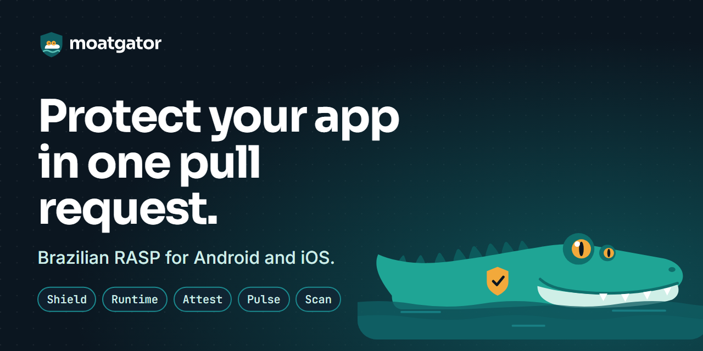

  

<h3 align="center">Runtime protection for mobile apps that move money.</h3>

  <a href="https://www.moatgator.com">Website</a> ·
  <a href="https://docs.moatgator.com">Docs</a> ·
  <a href="https://app.moatgator.com">Console</a> ·
  <a href="https://www.moatgator.com/blog">Blog</a> ·
  <a href="https://www.moatgator.com/trust">Trust center</a>

---

**Moatgator** is a RASP (runtime application self-protection) platform for Android and iOS, built in Brazil. Install the GitHub App and Moatgator opens a pull request that wires protection into your build. No SDK hunt and no hand-written obfuscation config.

| Module | What it does |
| --- | --- |
| **Shield** | Obfuscation and anti-tamper for Android and iOS, added to your build by a pull request |
| **Runtime** | Detects hostile environments (root, jailbreak, hooking, emulators, overlays) and responds by policy |
| **Attest** | Signed verdicts your backend can verify, proving the app and device are genuine |
| **Pulse** | Live visibility into what was attempted and stopped, by version, device and region |
| **Scan** | Upload an APK or IPA and get a free report of your app's protection gaps |
| **Pix Shield** *(coming soon)* | Protects payment screens against Brazilian banking trojans |

### Start here

- **Try it free:** the Hatchling plan protects your first app at no cost. [Create an account](https://app.moatgator.com/signup)
- **Scan an app:** [moatgator.com/scan](https://www.moatgator.com/scan) gives a first read of your app's protection gaps
- **Read the docs:** [quickstart for Android and iOS](https://docs.moatgator.com)

### Security

Found a vulnerability? Write to **security@moatgator.com**. Our disclosure policy is at [moatgator.com/trust](https://www.moatgator.com/trust#disclosure).

Moatgator is a product of GZ Segurança e Defesa Cibernética LTDA (CNPJ 40.988.106/0001-60), Cascavel, PR, Brazil.
